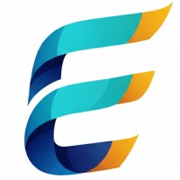

<h1 align="left">Hey there, I'm Han(nah) </h1>

Comp Sci + Math Student at the University of South Florida, building software that brings good to people. I've worked on ML tools at a cancer center, a nutrition platform with a hospital, and fullstack for healthcare and edu-tech startups. Lately I've been into real-time systems and making apps that hold up at scale - still exploring the world around me. Outside of code, I &lt;3 cats.

<picture>
  <source media="(prefers-color-scheme: dark)" srcset="https://raw.githubusercontent.com/XuanGiaHanNguyen/XuanGiaHanNguyen/output/github-snake-dark.svg" />
  
</picture>

## Experience

<table>
<tr>
<td width="50%" valign="top">

<b>Student Software Engineer, ML</b> 
Moffitt Cancer Center 
Aug 2025 – Present · Tampa, FL
 
 

<ul>
<li>LLM eval pipeline: <b>5 models</b>, <b>10+ benchmarks</b>, <b>96%</b> of published results reproduced</li>
<li>Validated pooling for <b>10,771 patients</b> across 4 modalities (<b>92%</b> match)</li>
</ul>
 
</td>
<td width="50%" valign="top">

<b>Student Software Engineer</b> 
ERA Lab · Tampa General Hospital 
Feb 2026 – Present · Tampa, FL
 
 

<ul>
<li>Food-as-medicine recommender: <b>1,100+</b> recipes for <b>63</b> clinical conditions</li>
<li>WebSocket streaming across <b>11</b> endpoints; <b>87%</b> test coverage</li>
</ul>
 
</td>
</tr>
<tr>
<td width="50%" valign="top">

<b>Software Engineer Intern</b> 
Guardiene AI · EdTech 
Aug 2025 – Feb 2026 · Tampa, FL
 
 

<ul>
<li>AI platform protecting kids from online predators</li>
<li><b>Sub-second</b> alerts via 3-layer caching; <b>95+</b> Lighthouse scores</li>
</ul>
 
</td>
<td width="50%" valign="top">

<b>Futureforce Participant</b> 
ServiceNow · West Palm Beach Summit 
Aug 2026 · West Palm Beach, FL
 
 

<ul>
<li>Won <b>Most Innovative Approach</b> for a ticket router with <b>50/50</b> correct routes</li>
<li>Ranked team queues + dashboard flagging <b>32</b> SLA breaches</li>
</ul>
 
</td>
</tr>
</table>

&nbsp; <b>Campus Ambassador</b> · Adobe · Aug 2026 – Present

&nbsp; <b>Active Member</b> · Rewriting the Code · May 2025 – Present

## Featured Projects
<table>
<tr>
<td width="50%" align="center" valign="top">
 

Turns a meeting recording into conflict-free calendar tasks, fully offline. DP scheduling · live updates in <b>~34ms</b>

 
</td>
<td width="50%" align="center" valign="top">
 

Factory-building game backed by a C++ production optimizer. <b>8</b> solvers side by side · <a href="https://processengine.onrender.com">Live demo</a>

 
</td>
</tr>
<tr>
<td width="50%" align="center" valign="top">
 

Real-time parking lot simulator drawn at <b>60fps</b>. <b>144</b> stalls · <b>50ms</b> engine ticks · <a href="https://parkcore-frontend.onrender.com">Live demo</a>

 
</td>
<td width="50%" align="center" valign="top">
 

Tutoring platform connecting K–12 students with peer tutors. Led a <b>4-person</b> team · Redis sped up tutor search <b>80%</b>

 
</td>
</tr>
</table>

## 🛠️ Tech Stack

| Category | Technologies  |
|---|---|
| **Languages** | &nbsp;&nbsp;&nbsp;&nbsp;&nbsp;&nbsp;&nbsp;&nbsp;&nbsp; |
| **Frameworks** | &nbsp;&nbsp;&nbsp;&nbsp;&nbsp;&nbsp;&nbsp;&nbsp;&nbsp; |
| **Tools** | &nbsp; |
| **Data, Cloud &amp; DevOps** | &nbsp;&nbsp;&nbsp;&nbsp;&nbsp;&nbsp;&nbsp;&nbsp;&nbsp;&nbsp;&nbsp;&nbsp; |
 

